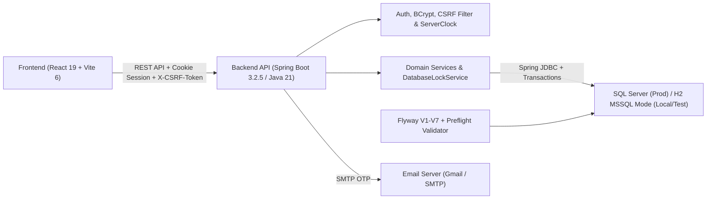

<<<<<<< Updated upstream
# An Cư — Hệ thống Quản lý & Cho thuê Căn hộ (Frontend React + Backend Java Spring Boot)

Dự án gồm **Frontend React + Vite** tại thư mục gốc và **Backend Java 21 + Spring Boot + Flyway + Microsoft SQL Server** tại thư mục `apartment-rental-backend/`.

## 1. Chạy Backend (`apartment-rental-backend`)

### Chạy với Microsoft SQL Server (SSMS 20)
1. Mở SSMS 20, tạo database trống `AnCuRental`.
2. Đảm bảo đã bật **TCP/IP (port 1433)** trong *SQL Server Configuration Manager* và chế độ đăng nhập **SQL Server and Windows Authentication mode** (tài khoản `sa` đã bật và đúng mật khẩu).
```powershell
$env:DB_URL="jdbc:sqlserver://localhost:1433;databaseName=AnCuRental;encrypt=true;trustServerCertificate=true"
$env:DB_USERNAME="sa"
$env:DB_PASSWORD="StrongPassword123!"
mvn -f apartment-rental-backend/pom.xml spring-boot:run
```

### Chạy nhanh Local (H2 ở chế độ tương thích MSSQLServer — không cần SQL Server)
```powershell
mvn -f apartment-rental-backend/pom.xml spring-boot:run "-Dspring-boot.run.profiles=local"
```

### Chạy kiểm thử tích hợp Backend (6 kịch bản nghiệm thu)
```powershell
mvn -f apartment-rental-backend/pom.xml test
```

## 2. Chạy Frontend React (`apartment-rental-frontend`)

Chạy bằng Node.js 22 trở lên. Vite đã được cấu hình proxy `/api` tới `http://localhost:8080`:

```powershell
npm.cmd ci
npm.cmd run dev
```

- Kiểm tra quy tắc nghiệp vụ phía Frontend: `npm.cmd test`
- Đóng gói bản dựng Production: `npm.cmd run build`

## 3. Tài khoản mẫu (Mật khẩu mặc định trên Backend: `AnCu@123`)

- **Nguyễn Minh Anh** (`t1` / `minhanh@ancu.vn` — `TENANT`): có hợp đồng `HD-1001` sắp hết hạn để thử phản hồi gia hạn và xem hóa đơn.
- **Trần Thu Hà** (`o1` / `thuha@ancu.vn` — `OWNER`): quản lý tòa nhà The River Thảo Điền & Urban Nest.
- **Lê Hoàng Nam** (`t2` / `hoangnam@ancu.vn` — `TENANT`): có hợp đồng `HD-1002` đã hết hạn và đã chọn không gia hạn.
- **Phạm Gia Bảo** (`o2` / `giabao@ancu.vn` — `OWNER`): quản lý tòa nhà Lumière Residence & The Greenhouse.

## 4. Quy tắc nghiệp vụ trọng tâm & Hai quyết định đã chốt

1. **Quyết định 1 — Xác nhận ký, thu tiền ban đầu (tiền đặt cọc) & hủy quá 3 ngày không nhận phòng**:
   - Địa điểm ký được sao lưu (snapshot) từ tòa nhà khi tạo hợp đồng. Đặt hoặc đổi lịch chỉ cập nhật ngày giờ hẹn ký theo múi giờ Việt Nam.
   - **Người môi giới / Chủ nhà (`OWNER`)** xác nhận khách hàng đã ký tại địa điểm hẹn (`signedAtLocation = true`) **và** ghi nhận đã thu khoản tiền đặt cọc trên hợp đồng (`depositReceived = true`). Khi hệ thống nhận đủ hai xác nhận này, hợp đồng chuyển sang **Đã ký (`SIGNED`)** và **Đã thu cọc (`PAID`)**, đồng thời tin đăng căn hộ tự động được ẩn.
   - Nếu đã quá **3 ngày** kể từ ngày dọn vào quy định trên hợp đồng (`today > startDate + 3 ngày`) mà khách hàng vẫn chưa nhận phòng thực tế (`actualMoveIn` trống), hợp đồng bị **hủy (`CANCELLED`)** và khách hàng **mất tiền đặt cọc (`depositForfeited = true`)**.
2. **Quyết định 2 — Tính tiền thuê kỳ đầu và kỳ cuối bắt đầu từ ngày dọn vào**:
   - Chu kỳ tính tiền thuê bắt đầu từ ngày dọn vào trên hợp đồng (`startDate`) theo thời hạn **1 tháng (`MONTH`)**, **1 năm (`YEAR`)** hoặc **thời gian khách hàng muốn thuê (`CUSTOM`)**.
   - **1 tháng** được tính theo số ngày của tháng bắt đầu chu kỳ (**30 hoặc 31 ngày**); **riêng tháng 2 luôn tính theo 30 ngày** kể từ ngày bắt đầu chu kỳ trên hợp đồng.
   - Kỳ cuối nếu lẻ ngày sẽ tính theo tỷ lệ `round(rent * daysInPeriod / monthBasisDays)`.
3. **Bàn giao sớm / trả phòng sớm & Gia hạn**:
   - Nhận phòng trước ngày bắt đầu hợp đồng tạo đúng một hóa đơn phạt bằng 1 tháng tiền thuê (`EARLY_MOVE_IN_PENALTY`). Trả phòng sớm giữ nguyên tiền thuê theo thỏa thuận.
   - Gia hạn tạo hợp đồng kỳ mới có mã riêng, liên kết với kỳ trước (`renewalOf`).

## Ảnh minh họa

Ảnh được tạo bằng công cụ ImageGen tích hợp và lưu trong `public/images`. Đây là hình minh họa cho dữ liệu mẫu.

- `hero.webp` dùng prompt: “Create a single photorealistic editorial architecture photograph for the hero banner of a premium Vietnamese apartment rental website. Widescreen 3:2 landscape or wider, high-end architecture magazine photography. Contemporary Ho Chi Minh City condo with floor-to-ceiling windows, very warm morning golden sunlight casting clean shadows, warm ivory linen curved sectional in the middle right, a walnut low coffee table, textured rug, indoor tree, muted taupe plaster, light oak wood, subtle high rise skyline in distance. Beautiful, plausible, understated high-end residential interior. The left third is a dark subdued shadowed wooden wall and furnishings in shadow, with no only focal subject there, designed to allow white text overlay later. Main focus on the bright right 65% of the image. No humans, no letters, no typography, no watermark, no graphics.”
- `river.webp`, `lumiere.webp`, `urban.webp` và `greenhouse.webp` dùng prompt: “Generate one high-resolution wide 1536 by 1024 image split EXACTLY into a 2 by 2 four-photo contact sheet with NO gutters and NO borders and NO overlap. Each exact quadrant is a different premium real estate editorial photograph used as a separate apartment listing crop. Top left: bright ivory and oak living room corner in Thao Dien with large balcony windows, pale sofa and round walnut table. Top right: cozy contemporary studio living room with mid-tone natural oak, clay cushions, curved cream sofa, modern art and leafy tree. Bottom left: sophisticated high-rise apartment living room, light grey sofa, walnut dining table, cyan blue sky visible through large windows. Bottom right: sunlit compact one-bedroom apartment with a forest green accent chair, cream sectional, green tree and polished light floors. Real Vietnamese urban apartments, photoreal natural light, refined and simple, editorial photography aesthetic. NO text, no people, no collage framing lines, no watermarks. Straight exact boundaries halfway horizontally and vertically. Four clearly independent scenes.”
=======
# An Cư — Hệ thống Quản lý & Cho thuê Căn hộ (Full-Stack)

**An Cư Rental** là ứng dụng web quản lý và cho thuê căn hộ tại TP. Hồ Chí Minh, phát triển theo kiến trúc **Monolithic Full-Stack phân tầng** với **React 19 + Vite 6** (`apartment-rental-frontend`) và **Java 21 + Spring Boot 3.2.5 + Spring JDBC + Flyway + Microsoft SQL Server** (`apartment-rental-backend`).

Hệ thống hỗ trợ trọn vẹn vòng đời cho thuê: khám phá căn hộ công khai, đăng ký & xác thực tài khoản qua email OTP, tạo/đặt lịch/xác nhận ký và thu tiền cọc (chống trùng lịch ở tầng CSDL), bàn giao nhận/trả phòng kèm chỉ số điện nước, tự động quét hủy quá hạn nhận phòng 3 ngày, lập hóa đơn tuần tự, xác nhận thanh toán idempotent và gia hạn hợp đồng.

---

## Mục lục

1. [Điểm nổi bật của hệ thống](#1-điểm-nổi-bật-của-hệ-thống)
2. [Kiến trúc & Cấu trúc thư mục](#2-kiến-trúc--cấu-trúc-thư-mục)
3. [Yêu cầu môi trường](#3-yêu-cầu-môi-trường)
4. [Hướng dẫn cài đặt & Khởi chạy](#4-hướng-dẫn-cài-đặt--khởi-chạy)
5. [Cấu hình biến môi trường](#5-cấu-hình-biến-môi-trường)
6. [Tài khoản mẫu để trải nghiệm](#6-tài-khoản-mẫu-để-trải-nghiệm)
7. [Quy tắc nghiệp vụ & Bảo đảm toàn vẹn dữ liệu](#7-quy-tắc-nghiệp-vụ--bảo-đảm-toàn-vẹn-dữ-liệu)
8. [Danh mục REST API chính](#8-danh-mục-rest-api-chính)
9. [Kiểm thử tự động & Đóng gói](#9-kiểm-thử-tự-động--đóng-gói)
10. [Bộ tài liệu kỹ thuật & Bảo vệ đồ án](#10-bộ-tài-liệu-kỹ-thuật--bảo-vệ-đồ-án)
11. [Xử lý sự cố thường gặp](#11-xử-lý-sự-cố-thường-gặp)

---

## 1. Điểm nổi bật của hệ thống

- **Ba không gian sử dụng rõ ràng:** Khám phá công khai (`/`), Cổng Khách thuê (`/tenant`) và Cổng Chủ nhà (`/owner`).
- **Tài khoản xác thực & bảo mật phiên:** Đăng ký bằng email OTP, chỉnh sửa hồ sơ, đổi/đặt lại mật khẩu qua OTP (thu hồi toàn bộ phiên cũ), băm mật khẩu bằng **BCrypt**, phiên đăng nhập `HttpOnly` cookie và bảo vệ **CSRF** (`XSRF-TOKEN` + `X-CSRF-Token` + kiểm tra `Origin`).
- **Toàn vẹn giao dịch & chống tranh chấp ở tầng CSDL:** Loại bỏ khóa cục bộ trong JVM; dùng khóa bi quan theo thứ tự chuẩn `Apartment → Contract` (`WITH (UPDLOCK, HOLDLOCK)` trên SQL Server, `FOR UPDATE` trên H2), kết hợp `version` optimistic locking và ràng buộc DB (`WITH CHECK`, filtered unique index).
- **Quản trị lược đồ thống nhất với Flyway (`V1` → `V7`):** Không chỉnh sửa các migration cũ `V1–V4`, kiểm tra xung đột dữ liệu trước khi nâng cấp (`MigrationPreflightValidator`), gắn nhãn trung thực dữ liệu cũ (`LEGACY_UNVERIFIED`) mà không tự bịa số liệu.
- **Khởi động minh bạch, không fallback ngầm:** Profile `sqlserver` áp dụng cơ chế **fail-fast** khi sai thông tin đăng nhập hoặc SQL Server không sẵn sàng; Frontend mặc định chạy **Application Mode** (không tự ghi dữ liệu giả vào `localStorage` khi API lỗi).

---

## 2. Kiến trúc & Cấu trúc thư mục



### Tổng quan phân hệ

| Phân hệ | Công nghệ | Tài liệu riêng | Vai trò chính |
|---|---|---|---|
| **Frontend** | React 19, Vite 6, React Router 7, Lucide React | [apartment-rental-frontend/README.md](apartment-rental-frontend/README.md) | Giao diện Công khai, Khách thuê, Chủ nhà; mặc định **Application Mode** đồng bộ trực tiếp với `/api/**` |
| **Backend** | Java 21, Spring Boot 3.2.5, Spring JDBC, Spring Security Crypto (BCrypt), Spring Scheduling | [apartment-rental-backend/README.md](apartment-rental-backend/README.md) | REST API `/api/**`, quản lý nghiệp vụ hợp đồng/hóa đơn, khóa CSDL, đồng hồ `ServerClock`, job quét no-show |
| **CSDL & Migration** | Microsoft SQL Server (SSMS 20), H2 (`MODE=MSSQLServer` chỉ cho local/test), Flyway (`flyway-core` + `flyway-sqlserver`) | [docs/DATABASE_MIGRATION.md](docs/DATABASE_MIGRATION.md) | Quản trị lược đồ thống nhất `V1` → `V7`, preflight dữ liệu, ràng buộc toàn vẹn theo dialect |

### Cấu trúc thư mục

```text
final_analysis/
├── package.json                             # Lệnh điều phối Full-Stack (dev, dev:sqlserver, build, test, test:sqlserver)
├── scripts/
│   ├── fullstack.mjs                        # Chạy song song Backend + Frontend, build & đồng bộ static
│   ├── dev-readiness.mjs                    # Kiểm tra /api/health & đúng databaseEngine theo chế độ chạy
│   ├── dev-readiness.test.mjs               # Unit test cho kiểm tra khởi động & chặn fallback H2
│   └── setup-gmail.mjs                      # Trợ lý cấu hình nhanh SMTP Gmail vào .env cục bộ
├── docs/                                    # Bộ tài liệu khắc phục, migration, kiểm thử, thiết kế & bảo vệ
│   ├── REMEDIATION_REPORT.md
│   ├── DATABASE_MIGRATION.md
│   ├── TEST_REPORT.md
│   ├── SYSTEM_DESIGN_UPDATE.md
│   └── DEMO_AND_DEFENSE_GUIDE.md
├── apartment-rental-frontend/
│   ├── src/                                 # main.jsx, shared.jsx, public.jsx, owner.jsx, contracts.jsx, account.jsx, demo.js
│   └── test/demo.test.js                    # Kiểm thử tính tiền thuê, Application Mode & CSRF
└── apartment-rental-backend/
    ├── .env.example                         # Mẫu biến môi trường (không chứa bí mật thật)
    ├── pom.xml                              # Cấu hình Maven (Java 21, Spring Boot 3.2.5, Flyway SQL Server)
    ├── docs/
    │   ├── EMAIL_SETUP.md                   # Hướng dẫn cấu hình SMTP & OTP
    │   └── sql/                             # 01_initialize_AnCuRental.sql, 02_inspect_AnCuRental.sql, 03_preflight_check_V5.sql
    └── src/
        ├── main/java/vn/ancu/rental/        # apartment/, auth/, common/, contract/, db/migration/V6, health/
        ├── main/resources/
        │   ├── application.yml              # Cấu hình nền (Flyway, CSRF, Session, SMTP)
        │   ├── application-sqlserver.yml    # Cấu hình riêng SQL Server (không có mật khẩu hardcode)
        │   ├── db/migration/                # V1__init_schema.sql .. V5__add_integrity_columns.sql
        │   └── db/dialect/{h2,sqlserver}/   # V7__enforce_business_constraints.sql theo từng dialect
        └── test/java/vn/ancu/rental/        # Bộ kiểm thử tích hợp, concurrency, schema upgrade & SQL Server
```

---

## 3. Yêu cầu môi trường

| Thành phần | Phiên bản yêu cầu | Ghi chú |
|---|---|---|
| **Node.js & npm** | Node.js `20.x` / `22.x` / `24.x` | Dùng cho Frontend và các script điều phối ở thư mục gốc |
| **Java JDK** | JDK **21+** | `maven.compiler.release = 21` |
| **Apache Maven** | Maven **3.9+** | Hoặc `mvn.cmd` có sẵn trong `PATH` trên Windows |
| **Cơ sở dữ liệu** | **H2** (tự tích hợp) hoặc **Microsoft SQL Server** (SSMS 20) | H2 chỉ dùng cho chế độ local/test; SQL Server dùng cho vận hành thật và yêu cầu cấu hình thông tin kết nối rõ ràng |

---

## 4. Hướng dẫn cài đặt & Khởi chạy

### Bước 0 — Chuẩn bị môi trường cục bộ (tùy chọn khi dùng SQL Server hoặc SMTP thật)

Sao chép [apartment-rental-backend/.env.example](apartment-rental-backend/.env.example) thành `apartment-rental-backend/.env` và điền thông số cục bộ của bạn.

> [!IMPORTANT]
> File `.env` đã được loại trừ trong `.gitignore`. **Tuyệt đối không commit `.env` lên Git và không đóng gói `.env` vào file nén khi bàn giao/nộp đồ án.**

### Cách 1 — Chạy phát triển Local với H2 (`MODE=MSSQLServer`)

Phù hợp để chạy nhanh không cần cài SQL Server. Script sẽ tự cài dependency cho Frontend (nếu chưa có), khởi chạy Backend trên H2 (tự áp dụng Flyway `V1` → `V7`), kiểm tra `/api/health` rồi mở Vite dev server:

```powershell
npm.cmd run dev
```

| Dịch vụ | Địa chỉ | Ghi chú |
|---|---|---|
| **Frontend UI** | `http://127.0.0.1:5173` | Tự proxy `/api/**` sang `http://127.0.0.1:8080` |
| **Backend Health** | `http://localhost:8080/api/health` | Trả `status: "UP"`, `databaseEngine: "H2"` |

### Cách 2 — Chạy với Microsoft SQL Server (Chế độ Fail-Fast)

1. **Chuẩn bị cơ sở dữ liệu `AnCuRental`:**
   - **Nếu DB mới tạo trống:** mở SSMS và chạy [01_initialize_AnCuRental.sql](apartment-rental-backend/docs/sql/01_initialize_AnCuRental.sql) để khởi tạo nền `V1–V4` trước khi Flyway nâng cấp `V5–V7`.
   - **Nếu DB đã có dữ liệu V3/V4:** **sao lưu (backup) trước** và chạy [03_preflight_check_V5.sql](apartment-rental-backend/docs/sql/03_preflight_check_V5.sql) để chắc chắn không có bản ghi xung đột. Chi tiết xem tại [docs/DATABASE_MIGRATION.md](docs/DATABASE_MIGRATION.md).
2. **Khai báo biến môi trường kết nối** (hoặc đặt trong `apartment-rental-backend/.env`):
   ```powershell
   $env:DB_URL = "jdbc:sqlserver://localhost:1433;databaseName=AnCuRental;encrypt=true;trustServerCertificate=true"
   $env:DB_USERNAME = "<tai_khoan_sql>"
   $env:DB_PASSWORD = "<mat_khau_sql>"
   npm.cmd run dev:sqlserver
   ```
3. **Xác minh sau khởi chạy:**
   - Flyway tự chạy `MigrationPreflightValidator`, xác minh dấu vết `V3/V4` và áp dụng `V5` → `V6` → `V7`.
   - `http://localhost:8080/api/health` phải trả `databaseEngine: "Microsoft SQL Server"`.
   - Nếu sai cấu hình hoặc SQL Server chưa mở, tiến trình **dừng ngay (`fail-fast`)** và không fallback ngầm sang H2.

### Cách 3 — Đóng gói & Chạy hợp nhất trên một cổng (`8080`)

Build giao diện React và sao chép vào `apartment-rental-backend/src/main/resources/static`, sau đó chạy trực tiếp qua Spring Boot:

```powershell
npm.cmd run build

# Chạy bản đóng gói trên Local H2
npm.cmd run start:local

# Hoặc chạy bản đóng gói với Microsoft SQL Server (sau khi cấu hình DB_URL/DB_USERNAME/DB_PASSWORD)
npm.cmd run start
```

Sau khi khởi động, truy cập toàn bộ ứng dụng tại `http://localhost:8080`.

### Cấu hình gửi Email OTP thật

Nếu muốn dùng tính năng đăng ký/đặt lại mật khẩu gửi OTP qua Gmail SMTP thật, chạy trợ lý cấu hình hoặc xem [apartment-rental-backend/docs/EMAIL_SETUP.md](apartment-rental-backend/docs/EMAIL_SETUP.md):

```powershell
npm.cmd run setup:email
```

---

## 5. Cấu hình biến môi trường

Danh sách đầy đủ tham khảo tại [apartment-rental-backend/.env.example](apartment-rental-backend/.env.example):

| Biến môi trường | Áp dụng | Giá trị mặc định | Mô tả |
|---|---|---|---|
| `DB_URL` | Backend (`sqlserver`) | *(Bắt buộc)* | JDBC URL kết nối SQL Server (ví dụ `jdbc:sqlserver://localhost:1433;databaseName=AnCuRental;encrypt=true;trustServerCertificate=true`) |
| `DB_USERNAME` | Backend (`sqlserver`) | *(Bắt buộc)* | Tên đăng nhập SQL Server |
| `DB_PASSWORD` | Backend (`sqlserver`) | *(Bắt buộc)* | Mật khẩu SQL Server (không có mật khẩu hardcode trong mã nguồn) |
| `SMTP_HOST`, `SMTP_PORT` | Backend | `smtp.gmail.com`, `587` | Máy chủ SMTP gửi mã OTP |
| `SMTP_USERNAME`, `SMTP_PASSWORD`, `SMTP_FROM` | Backend | *(Trống)* | Tài khoản & App Password SMTP gửi OTP |
| `SMTP_AUTH`, `SMTP_STARTTLS`, `SMTP_SSL` | Backend | `true`, `true`, `false` | Tùy chọn xác thực và mã hóa TLS cho SMTP |
| `SESSION_COOKIE_SECURE` | Backend | `false` | Đặt `true` khi triển khai sau HTTPS |
| `CSRF_ENABLED` | Backend | `true` | Bật/tắt bộ lọc kiểm tra CSRF (`XSRF-TOKEN` / `X-CSRF-Token`) |
| `CORS_ALLOWED_ORIGINS` | Backend | `http://localhost:5173,...` | Danh sách origin được phép gọi API kèm credential |
| `VITE_API_TARGET` | Frontend (dev) | `http://127.0.0.1:8080` | Địa chỉ Backend mà Vite proxy `/api` chuyển tiếp tới |
| `VITE_APP_MODE` | Frontend | *(Trống = Application Mode)* | Đặt `prototype` **chỉ khi** muốn xem bản dựng giao diện ngoại tuyến không cần backend |

---

## 6. Tài khoản mẫu để trải nghiệm

Cơ sở dữ liệu seed (`V2__seed_data.sql` + `V4__verified_accounts.sql`) khởi tạo 4 tài khoản mẫu đã xác thực với mật khẩu dùng chung (băm **BCrypt**): **`AnCu@123`**.

| Mã TK | Họ và tên | Email đăng nhập | Vai trò | Dữ liệu mẫu gắn kèm |
|---|---|---|---|---|
| `t1` | **Nguyễn Minh Anh** | `minhanh@ancu.vn` | `TENANT` | Hợp đồng `HD-1001` (sắp hết hạn trong 8 ngày) và hóa đơn `HĐ-1001` chưa thanh toán |
| `t2` | **Lê Hoàng Nam** | `hoangnam@ancu.vn` | `TENANT` | Hợp đồng `HD-1002` đã hết hạn, đã phản hồi *Không gia hạn* |
| `o1` | **Trần Thu Hà** | `thuha@ancu.vn` | `OWNER` | Chủ quản **The River Thảo Điền**, **Urban Nest** và hợp đồng `HD-1001` |
| `o2` | **Phạm Gia Bảo** | `giabao@ancu.vn` | `OWNER` | Chủ quản **Lumière Residence**, **The Greenhouse** và hợp đồng `HD-1002` |

---

## 7. Quy tắc nghiệp vụ & Bảo đảm toàn vẹn dữ liệu

1. **Snapshot hợp đồng bất biến & giá thuê do server quyết định:**
   - Khách thuê (`TENANT`) không thể tự chỉnh giá thuê/tiền cọc khi tạo hoặc sửa yêu cầu hợp đồng; Backend luôn đọc đơn giá từ bảng `apartments` và đặt cọc mặc định = 1 tháng tiền thuê.
   - Chủ nhà (`OWNER`) chỉ chỉnh sửa được hợp đồng thuộc tài sản mình quản lý ở trạng thái `AWAITING`. Sau khi tạo/ký, snapshot giá và địa điểm ký được giữ nguyên.
2. **Xác nhận ký & thu tiền cọc thực nhận + Chống trùng lịch ở tầng DB:**
   - Chủ nhà bắt buộc xác nhận đã ký tại điểm hẹn, đã thu cọc và nhập **số tiền cọc thực nhận** `>= deposit_amount` (lưu `deposit_received_amount` và `deposit_verification_status = 'VERIFIED'`).
   - Giao dịch giữ khóa bi quan theo thứ tự chuẩn `Apartment → Contract` đến khi commit/rollback, ngăn hai hợp đồng cùng căn hộ ký chồng lịch (bao gồm trùng ngày biên inclusive).
3. **Bàn giao nhận/trả phòng & Hạn 3 ngày No-Show theo `ServerClock`:**
   - Tách rõ `POST /api/contracts/{id}/check-in` (bắt buộc nhập chỉ số điện/nước ban đầu `handover_electric_reading`, `handover_water_reading`) và `POST /api/contracts/{id}/check-out` (bảo toàn mốc nhận phòng).
   - Nhận phòng sớm (`actualMoveIn < startDate`) phát sinh đúng 1 hóa đơn phạt `EARLY_MOVE_IN` = 1 tháng thuê; nếu đã `PAID` sẽ không bao giờ bị xóa hay ghi đè.
   - Mọi kiểm tra quá hạn nhận phòng `start_date + 3 ngày` (cả thủ công và job định kỳ `NoShowCancellationJob`) chỉ dùng `ServerClock` (`Asia/Ho_Chi_Minh`), không chấp nhận ngày do client gửi.
4. **Chu kỳ tính tiền thuê (`LeaseRentCalculator`):**
   - Tháng 1, 3, 5, 7, 8, 10, 12 tính 31 ngày; tháng 4, 6, 9, 11 tính 30 ngày; **tháng 2 (kể cả năm thường và năm nhuận) luôn tính 30 ngày** từ ngày bắt đầu.
   - Kỳ cuối lẻ ngày tính tỷ lệ `round(monthlyRent * actualDays / basisDays)`. Trả phòng sớm vẫn giữ nguyên tổng tiền thuê theo thỏa thuận.
5. **Hóa đơn tuần tự theo `period_index` & Thu tiền Idempotent:**
   - Mỗi hợp đồng chỉ có tối đa 1 hóa đơn `MONTHLY` cho mỗi `period_index` (khóa ở tầng DB).
   - Kỳ 1 lấy chỉ số bàn giao đã xác minh; kỳ `k > 1` nối tiếp chỉ số chốt kỳ `k - 1` (không bỏ kỳ, không sửa lùi chỉ số).
   - Xác nhận thanh toán (`POST /api/invoices/{id}/confirm-paid`) cập nhật nguyên tử `WHERE status = 'UNPAID'`, gọi lặp hoặc đồng thời vẫn giữ nguyên `paid_at` và `confirmed_by` ban đầu.
6. **Gia hạn bằng hợp đồng mới độc lập:**
   - Đồng ý gia hạn sinh hợp đồng mới liên kết qua `renewal_of_id` để giữ nguyên lịch sử hợp đồng gốc; mỗi hợp đồng cũ chỉ có tối đa 1 hợp đồng gia hạn chưa hủy (filtered unique index / guard unique index).

---

## 8. Danh mục REST API chính

> [!NOTE]
> Mọi yêu cầu ghi dữ liệu (`POST`, `PUT`, `PATCH`, `DELETE`) trên `/api/**` khi đã có phiên đăng nhập phải kèm header `X-CSRF-Token` khớp giá trị cookie `XSRF-TOKEN` (có thể khởi tạo qua `GET /api/auth/csrf`). Mọi lỗi trả theo định dạng thống nhất `ApiErrorResponse` (`code`, `message`, `path`, `timestamp`, `details`) và không làm lộ stacktrace/SQL.

| Nhóm | Phương thức & Endpoint | Quyền hạn | Chức năng |
|---|---|---|---|
| **Hệ thống** | `GET /api/health` | Công khai | Tình trạng hệ thống (`UP`/`DOWN`), `databaseEngine`, `activeProfiles`, `timezone` |
| **Xác thực & Tài khoản** | `GET /api/auth/csrf` | Công khai | Cấp/đồng bộ CSRF token (`XSRF-TOKEN` + `X-CSRF-Token`) |
| | `POST /api/auth/login`, `POST /api/auth/logout`, `GET /api/auth/me` | Công khai / Đã ĐN | Đăng nhập BCrypt (xoay session & CSRF token), đăng xuất, lấy phiên hiện tại |
| | `GET /api/auth/accounts`, `GET /api/auth/contacts` | Công khai / Đã ĐN | Danh sách tài khoản mẫu và liên hệ liên quan |
| | `POST /api/auth/register/{request-otp,confirm}` | Công khai | Đăng ký khách thuê xác thực bằng email OTP |
| | `GET / PUT /api/auth/profile` | Đã đăng nhập | Xem và cập nhật thông tin hồ sơ cá nhân |
| | `POST /api/auth/password/{change,reset}/{request-otp,confirm}` | Đã ĐN / Công khai | Đổi/đặt lại mật khẩu qua OTP và vô hiệu toàn bộ session cũ |
| **Khám phá công khai** | `GET /api/public/apartments`, `GET /api/public/apartments/{id}` | Công khai | Tìm kiếm tiếng Việt không dấu, lọc, sắp xếp và phân trang SQL (`OFFSET/FETCH`) |
| **Quản lý Chủ nhà** | `GET /api/owner/dashboard` | `OWNER` | Thống kê tổng quan thời gian thực |
| | `GET / POST / PUT /api/owner/buildings[/{id}]` | `OWNER` | Quản lý tòa nhà thuộc quyền sở hữu |
| | `GET / POST / PUT /api/owner/apartments[/{id}]` | `OWNER` | Quản lý căn hộ (khóa DB khi chuyển bảo trì) |
| | `PATCH /api/owner/apartments/{id}/{listing,publish}` | `OWNER` | Cập nhật nội dung tin đăng và mở/ẩn tin cho thuê |
| **Vòng đời Hợp đồng** | `GET / POST /api/contracts`, `GET / PUT /api/contracts/{id}` | `OWNER`, `TENANT` | Tạo/xem/sửa hợp đồng ở trạng thái chờ ký (`AWAITING`) |
| | `POST /api/contracts/{id}/{schedule,cancel}` | `OWNER`, `TENANT` | Đặt lịch hẹn ký (theo `ServerClock`) / hủy hợp đồng chờ ký |
| | `POST /api/contracts/{id}/confirm-sign-and-deposit` | `OWNER` | Xác nhận ký tại điểm hẹn & ghi nhận số tiền cọc thực nhận (`receivedAmount`) |
| | `POST /api/contracts/{id}/check-in` | `OWNER` | Ghi nhận ngày nhận phòng & chỉ số điện/nước bàn giao ban đầu |
| | `POST /api/contracts/{id}/check-out` | `OWNER` | Ghi nhận ngày trả phòng (bảo toàn nhận phòng và khoản phạt đã thu) |
| | `POST /api/contracts/{id}/handover` | `OWNER` | Endpoint bàn giao tổng hợp tương thích ngược (trường `null` không xóa dữ liệu) |
| | `POST /api/contracts/{id}/cancel-no-show` | `OWNER` | Hủy hợp đồng & giữ cọc sau 3 ngày theo `ServerClock` |
| | `GET /api/contracts/{id}/{history,rent-schedule}` | `OWNER`, `TENANT` | Lịch sử trạng thái và bảng phân bổ chu kỳ tiền thuê |
| | `GET /api/contracts/rent-preview` | Công khai | Xem trước bảng tính tiền thuê (kiểm soát biên đầu vào) |
| | `GET /api/contracts/renewal-notices`, `POST /api/contracts/{id}/renewal` | `OWNER`, `TENANT` | Thông báo nhắc gia hạn 30 ngày & xử lý gia hạn |
| **Hóa đơn** | `GET /api/contracts/{id}/next-invoice-preview` | `OWNER` | Xem kỳ lập hóa đơn kế tiếp & chỉ số cũ do server xác định |
| | `POST /api/contracts/{id}/invoices` | `OWNER` | Lập hóa đơn tuần tự (khóa hợp đồng, chống trùng kỳ `period_index`) |
| | `GET /api/invoices[/{id}]`, `POST /api/invoices/{id}/confirm-paid` | `OWNER`, `TENANT` | Tra cứu hóa đơn (batch JOIN, không N+1) & xác nhận thanh toán idempotent |
| **Yêu thích** | `GET /api/favorites`, `POST /api/favorites/{apartmentId}/toggle` | Đã đăng nhập | Danh sách và bật/tắt căn hộ đã lưu |

---

## 9. Kiểm thử tự động & Đóng gói

### Các lệnh kiểm thử và build

```powershell
# Chạy toàn bộ bộ kiểm thử chuẩn (startup + frontend + backend H2)
npm.cmd test

# Hoặc chạy từng nhóm riêng lẻ
npm.cmd run test:startup      # Kiểm tra dev-readiness & chặn fallback H2
npm.cmd run test:frontend     # Kiểm thử nghiệp vụ Frontend, Application Mode & CSRF
npm.cmd run test:backend      # Bộ integration & concurrency test Spring Boot (H2)

# Đóng gói full-stack (Vite build -> copy static vào Backend -> Maven test-compile)
npm.cmd run build
```

### Chạy kiểm thử đa instance & nâng cấp trên Microsoft SQL Server thật

Dùng một **cơ sở dữ liệu kiểm thử tách biệt** (không dùng DB vận hành `AnCuRental`):

```powershell
$env:ANCU_TEST_SQLSERVER_URL = "jdbc:sqlserver://localhost:1433;databaseName=AnCuRental_Test;encrypt=true;trustServerCertificate=true"
$env:ANCU_TEST_SQLSERVER_UPGRADE_URL = "jdbc:sqlserver://localhost:1433;databaseName=AnCuRental_UpgradeTest;encrypt=true;trustServerCertificate=true"
$env:ANCU_TEST_SQLSERVER_USERNAME = "<sql_test_user>"
$env:ANCU_TEST_SQLSERVER_PASSWORD = "<sql_test_password>"
npm.cmd run test:sqlserver
```

### Tổng hợp kết quả xác minh gần nhất

| Hạng mục | Kết quả | Chi tiết |
|---|---|---|
| Startup readiness (`test:startup`) | **4 / 4 PASS** | Xác nhận chặn fallback H2 khi chạy `--sqlserver` |
| Frontend (`test:frontend`) | **8 / 8 PASS** | Bao gồm Application Mode (không fallback `localStorage`) & truyền CSRF token |
| Backend integration & concurrency (`test:backend`) | **46 / 46 active PASS** | 0 FAIL, 2 SKIPPED (`SqlServerVerificationIntegrationTest` khi chưa cấp biến `ANCU_TEST_SQLSERVER_*`) |
| Xác minh trực tiếp trên SQL Server thật (DB tạm tách biệt) | **17 / 17 PASS** | Chạy `V1–V7`, `WITH CHECK`, filtered unique index, `OFFSET/FETCH`, khóa `WITH (UPDLOCK, HOLDLOCK)` 2 kết nối đồng thời |
| Full-stack build (`npm.cmd run build`) | **EXIT 0** | Build Vite, đồng bộ static và `mvn test-compile` thành công |

> Xem nhật ký đầy đủ và ma trận **T01–T24** (gồm trạng thái `BLOCKED` của T02 đa JVM khi chưa có SQL Auth test credentials) tại [docs/TEST_REPORT.md](docs/TEST_REPORT.md).

---

## 10. Bộ tài liệu kỹ thuật & Bảo vệ đồ án

| Tài liệu | Nội dung chính |
|---|---|
| [docs/REMEDIATION_REPORT.md](docs/REMEDIATION_REPORT.md) | Báo cáo chi tiết kết quả khắc phục theo từng mã lỗi `P0-01` → `P2-03`, bằng chứng và điểm còn mở |
| [docs/DATABASE_MIGRATION.md](docs/DATABASE_MIGRATION.md) | Quy trình preflight, backup, nâng cấp SQL Server/H2 `V1–V7`, xử lý `LEGACY_UNVERIFIED` và rollback |
| [docs/TEST_REPORT.md](docs/TEST_REPORT.md) | Môi trường, lệnh thực thi, kết quả thực tế tách riêng H2 và SQL Server, ma trận `T01–T24` |
| [docs/SYSTEM_DESIGN_UPDATE.md](docs/SYSTEM_DESIGN_UPDATE.md) | Cập nhật ERD (`V5–V7`), Use Case, Activity và Sequence Diagram sau khi hoàn thiện |
| [docs/DEMO_AND_DEFENSE_GUIDE.md](docs/DEMO_AND_DEFENSE_GUIDE.md) | Kịch bản demo 12–15 phút và bộ câu hỏi/trả lời phản biện hội đồng |
| [apartment-rental-backend/docs/EMAIL_SETUP.md](apartment-rental-backend/docs/EMAIL_SETUP.md) | Hướng dẫn cấu hình SMTP Gmail App Password cho tính năng OTP |
| [apartment-rental-backend/docs/sql/README.md](apartment-rental-backend/docs/sql/README.md) | Hướng dẫn chạy các script khởi tạo, kiểm tra và preflight trong SSMS |

---

## 11. Xử lý sự cố thường gặp

- **Lỗi cổng `8080` đang được sử dụng khi chạy `npm.cmd run dev`:** Dừng tiến trình Spring Boot/Java cũ đang lắng nghe cổng `8080` (hoặc đặt `SERVER_PORT` khác) rồi chạy lại.
- **Backend dừng ngay khi chạy `npm.cmd run dev:sqlserver`:** Đây là hành vi **fail-fast** có chủ đích. Kiểm tra dịch vụ SQL Server đã chạy (cổng TCP `1433`), database `AnCuRental` đã tồn tại và biến `DB_URL`, `DB_USERNAME`, `DB_PASSWORD` đã hợp lệ.
- **Lỗi `403 CSRF_TOKEN_INVALID` khi gọi API bằng công cụ ngoài (Postman/curl):** Gọi `GET /api/auth/csrf` trước (giữ cookie jar), sau đó gửi kèm header `X-CSRF-Token` bằng giá trị cookie `XSRF-TOKEN` trong mọi request `POST/PUT/PATCH/DELETE` sau khi đăng nhập.
- **Flyway dừng ở bước preflight trước khi chạy `V7`:** Cơ sở dữ liệu hiện có đang chứa dữ liệu vi phạm ràng buộc mới (ví dụ hợp đồng chồng lịch hoặc hóa đơn trùng kỳ). Chạy [03_preflight_check_V5.sql](apartment-rental-backend/docs/sql/03_preflight_check_V5.sql) và xử lý theo hướng dẫn trong [docs/DATABASE_MIGRATION.md](docs/DATABASE_MIGRATION.md).
>>>>>>> Stashed changes
