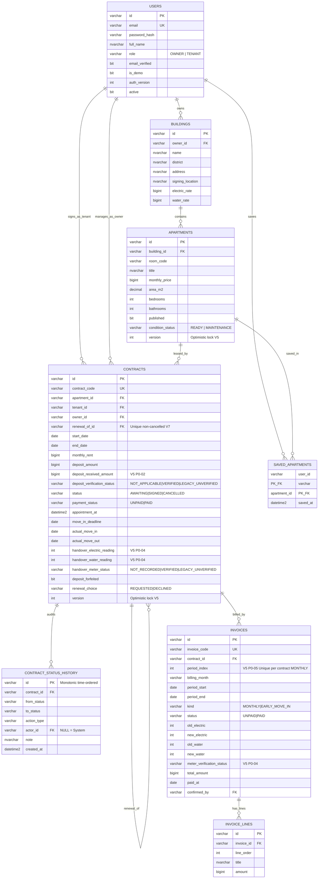
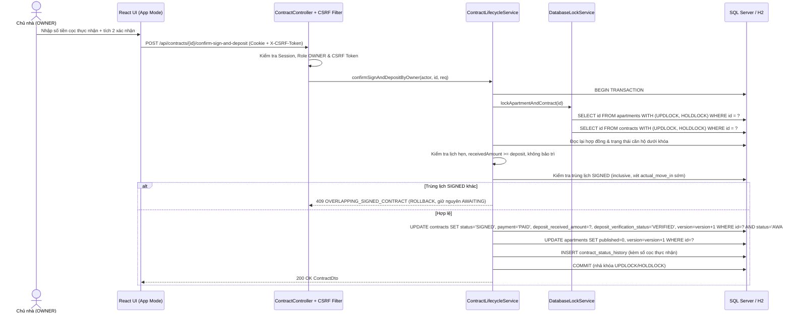

# Cập nhật Thiết kế Hệ thống (ERD, Use Case, Activity & Sequence Diagrams)

> **Lưu ý phạm vi:** Tài liệu này cập nhật thiết kế hệ thống **An Cư Rental** khớp 100% với source code và lược đồ cơ sở dữ liệu sau khi khắc phục P0/P1/P2 (phiên bản lược đồ `V7`). Tài liệu này là bản bổ sung kỹ thuật trong repository, **không thay thế** tài liệu báo cáo đồ án chính thức nộp cho giảng viên (nếu báo cáo đó được lưu bên ngoài repository).

## 1. Biểu đồ thực thể liên kết (ERD — Lược đồ V7)



## 2. Biểu đồ Tuần tự (Sequence Diagrams) các luồng trọng yếu

### 2.1. Xác nhận ký & thu tiền cọc với khóa CSDL chống trùng lịch (P0-01 & P0-02)



### 2.2. Bàn giao nhận/trả phòng & Bảo toàn hóa đơn phạt nhận phòng sớm (P0-04, P0-06, P0-07)

```mermaid
sequenceDiagram
    actor Owner as Chủ nhà (OWNER)
    participant Svc as ContractLifecycleService
    participant Lock as DatabaseLockService
    participant DB as SQL Server / H2

    Owner->>Svc: POST /api/contracts/{id}/check-in (actualMoveIn, initialElectric, initialWater)
    Svc->>DB: BEGIN TRANSACTION
    Svc->>Lock: lockApartmentAndContract(id)
    Svc->>Svc: Kiểm tra ServerClock (không ngày tương lai, <= start_date + 3, chỉ số >= 0)
    alt actualMoveIn < start_date
        Svc->>DB: Kiểm tra trùng lịch giai đoạn nhận sớm
        Svc->>DB: Upsert hóa đơn EARLY_MOVE_IN (giữ nguyên nếu PAID; cập nhật tại chỗ nếu UNPAID)
    end
    Svc->>DB: UPDATE contracts SET actual_move_in=?, handover_electric_reading=?, handover_water_reading=?, handover_meter_status='VERIFIED', version=version+1
    Svc->>DB: INSERT contract_status_history & COMMIT

    Note over Owner,DB: Sau đó khi khách trả phòng
    Owner->>Svc: POST /api/contracts/{id}/check-out (actualMoveOut)
    Svc->>DB: BEGIN TRANSACTION + lockApartmentAndContract(id)
    Svc->>Svc: Giữ nguyên actual_move_in & handover meters; kiểm tra actualMoveOut >= actualMoveIn
    Svc->>Svc: Hóa đơn EARLY_MOVE_IN đã PAID được giữ nguyên 100% (không DELETE)
    Svc->>DB: UPDATE contracts SET actual_move_out=?, version=version+1 & COMMIT
```

### 2.3. Lập hóa đơn tuần tự & xác nhận thu tiền Idempotent (P0-04, P0-05, P1-12)

```mermaid
sequenceDiagram
    actor Owner as Chủ nhà (OWNER)
    participant UI as OwnerBilling UI
    participant Svc as ContractLifecycleService
    participant DB as SQL Server / H2

    UI->>Svc: GET /api/contracts/{id}/next-invoice-preview
    Svc-->>UI: Kỳ kế tiếp (periodIndex, billingMonth) + Điện/Nước cũ (read-only)
    Owner->>UI: Nhập chỉ số Điện mới, Nước mới
    UI->>Svc: POST /api/contracts/{id}/invoices
    Svc->>DB: BEGIN TRANSACTION + lockContract(id)
    Svc->>Svc: resolveTargetPeriod từ LeaseRentCalculator (từ chối lệch month/periodIndex)
    Svc->>DB: Kiểm tra tuần tự (Kỳ 1 <- handover VERIFIED; Kỳ k <- Kỳ k-1)
    Svc->>DB: INSERT invoices (period_index, meter_verification_status='VERIFIED') + 3 invoice_lines
    Svc->>DB: COMMIT

    Owner->>Svc: POST /api/invoices/{invoiceId}/confirm-paid (có thể gọi lặp/đồng thời)
    Svc->>DB: BEGIN TRANSACTION + lockContract(contractId)
    Svc->>DB: UPDATE invoices SET status='PAID', paid_at=serverToday, confirmed_by=actorId WHERE id=? AND status='UNPAID'
    Svc->>DB: COMMIT -> Trả bản ghi đã lưu (bảo toàn paid_at & confirmed_by đầu tiên)
```

## 3. Cập nhật Use Case & Quy tắc Hoạt động (Activity Rules)

| Use Case | Tác nhân | Điều kiện tiên quyết mới sau khắc phục | Kết quả đảm bảo |
|---|---|---|---|
| **UC-01 Yêu cầu thuê** | `TENANT` | Căn hộ đang mở & sẵn sàng; giá và cọc do server tự lấy từ CSDL | Chặn gian lận giá/cọc; không tạo trùng với yêu cầu đang mở của chính khách |
| **UC-02 Ký hợp đồng & thu cọc** | `OWNER` | Có lịch hẹn ký, xác nhận ký tại điểm hẹn, nhập số cọc thực nhận `>= deposit` | Khóa CSDL chống 2 hợp đồng `SIGNED` trùng lịch; lưu `deposit_received_amount` |
| **UC-03 Hủy quá hạn 3 ngày (No-Show)** | `OWNER` / `Hệ thống` | `ServerClock.today() > start_date + 3` và `actual_move_in IS NULL` | Dùng khóa chung với Check-in; không thể giả mạo ngày `today` từ client |
| **UC-04 Nhận phòng (Check-in)** | `OWNER` | Hợp đồng `SIGNED`, nhập `actualMoveIn`, `initialElectric >= 0`, `initialWater >= 0` | Lưu mốc chỉ số điện/nước ban đầu; phát sinh đúng 1 phạt nhận sớm nếu `actualMoveIn < start_date` |
| **UC-05 Trả phòng (Check-out)** | `OWNER` | Đã có `actualMoveIn`, `actualMoveOut >= actualMoveIn` và `<= ServerClock.today()` | Bảo toàn `actualMoveIn`, chỉ số bàn giao và hóa đơn phạt đã `PAID`; tiền thuê không giảm |
| **UC-06 Lập hóa đơn theo kỳ** | `OWNER` | Đã bàn giao xác minh (kỳ 1) hoặc đã lập kỳ liền trước (kỳ `k > 1`) | Duy nhất 1 hóa đơn/`(contract_id, period_index)`; chỉ số liên tục không thể sửa lùi |
| **UC-07 Xác nhận thu hóa đơn** | `OWNER` | Hóa đơn thuộc quyền sở hữu của chủ nhà | Idempotent & nguyên tử; giữ nguyên `paid_at` và `confirmed_by` ban đầu |
| **UC-08 Gia hạn hợp đồng** | `TENANT` → `OWNER` | Trong mốc 30 ngày cuối; mỗi hợp đồng cũ chỉ có tối đa 1 hợp đồng gia hạn chưa hủy | Bảo toàn hợp đồng cũ; khóa + filtered unique index chống tạo 2 hợp đồng gia hạn song song |
